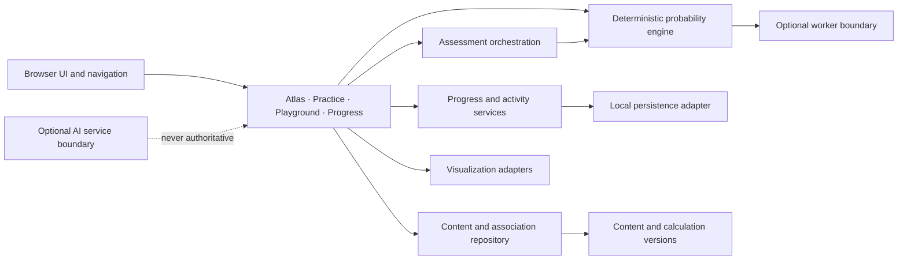

# A-007 — Technical Architecture

**Project:** Probability Revision Studio  
**Document ID:** A-007  
**Version:** 0.1  
**Date:** 14 November 2026  
**Status:** Draft architecture proposal; technology choices require review  
**Related documents:** PRS-PAS-001 v0.1; A-001 v0.4; A-002 v0.4; A-003 v0.4; A-004 v0.2; A-004/A-005 Shared Contracts v0.2; A-005 v0.2; A-006 v0.1; A-008 v0.1

---

## 1. Purpose and decision boundary

Define a modular browser application architecture that implements the approved product direction and provides a concrete, reviewable technology proposal. This document does not authorize implementation. Technology candidates and the proposed baseline below remain pending approval; implementation starts only after the relevant design stage is explicitly approved, as required by the Product & Architecture Specification.

### 1.1 Approved constraints

- Browser-based learning environment with Concept Atlas, Practice Gym and Probability Playground as co-equal entry points.
- Modular separation among presentation, structured educational content, deterministic computation, visualization, assessment, progress/revision, and optional AI.
- No external account or cloud database is required for initial use; local progress storage is the current direction.
- Mathematical computation, validation, simulation and scored answer checking are deterministic. LLM services are optional and never authoritative for mathematical results.
- API credentials must not be exposed in browser code.
- A-002/A-003/A-004/A-005/A-006 define behavior and logical contracts; A-007 selects implementation boundaries and mechanisms without changing those contracts.
- The six initial guided labs remain PL-01–PL-06. PL-07–PL-09 remain proposed. The custom finite experiment builder is separate from parameterized distribution explorers.

### 1.2 Proposed baseline (not approved)

| Concern | Proposed starting point | Rationale / condition |
|---|---|---|
| UI framework | React | Component composition fits the screen and reusable lab/control patterns; preserve a clean domain boundary so UI can be replaced. |
| Build/development | Vite | Provides a modern dev server and production build pipeline; framework integration remains replaceable. |
| Application language | TypeScript with strict checking | Makes content, result status, versions, response parts and state transitions explicit at compile time; runtime input still requires validation. |
| Mathematical core | Framework-independent TypeScript modules | Pure deterministic operations can be used by labs and A-006 checking without coupling them to React. Exact rational operations use explicit numerator/denominator representation; numerical algorithms remain those defined in A-004. |
| Heavy/long operations | Dedicated Web Worker for simulation or expensive calculations when responsiveness needs it | Keep the UI responsive; worker messages use versioned typed requests/results and can be cancelled without claiming partial completion. Not required for every calculation. |
| Local persistence | IndexedDB behind a persistence adapter | Supports structured local records and migration; browser-local data is not a backup, so provide versioned export/import before relying on it for durable progress. |
| Small preferences | Browser storage adapter, mechanism TBD | Store only noncritical preferences outside the primary data model; preference loss must not corrupt learner records. |
| Mathematics rendering | KaTeX as the first candidate | Fast client-side TeX rendering candidate; verify required command coverage, accessibility output, copy behavior and content security before selection. |
| Visualization | Accessible semantic tables plus a replaceable chart adapter; SVG-first for simple diagrams | The table/text equivalent is normative; chart library choice waits for PL-01–PL-06 prototypes and accessibility review. |
| Search | Indexed search over approved A-005 fields, replaceable adapter | Keep ranking/index implementation separate from authoring records; transcript-wide search remains a product/content decision. |
| Optional AI | Disabled-by-default service boundary; server-side mediator required if enabled | No provider key or direct provider credential in the browser; deterministic engine remains the authority. No AI service is required for the initial application. |

React, Vite, TypeScript, Web Workers, IndexedDB, KaTeX and Playwright are candidates, not approved dependencies. Their official documentation supports the stated capability descriptions; a prototype, browser-support review, license review and accessibility review are still required before adoption.

## 2. System context and module boundaries

| Module boundary | Owns | Must not own |
|---|---|---|
| Application shell | Global navigation, route resolution, focus/return context and app-level error handling | Curriculum rules or calculation formulas |
| Feature areas | Screen-specific state and interactions for Atlas, Practice, Playground, Dashboard, Formula Reference and Progress | Duplicated calculation implementations or direct persistence details |
| Content repository | A-005 entities, IDs, associations, source references, release/version metadata and approved content lookup | Mutable learner records or executable math formulas hidden in UI copy |
| Calculation package | A-004 CAL operations, validation, exact/numeric outputs, status/precision and simulation contracts | DOM/UI, learner progress policy, unseeded ambient random calls |
| Assessment package | A-006 response schemas, attempt orchestration, rubric application and feedback selection | Its own competing math engine, LLM-authoritative grading |
| Progress/revision services | A-005 learner evidence; apply only approved mastery/review policy | Assumed mastery or schedule rules not yet approved |
| Persistence adapter | Save/load, schema migrations, export/import and storage failure reporting | Silent data loss or interpretation of educational status |
| Visualization adapter | Charts, tables and accessibility equivalents for supplied data | Computing probability independently of A-004 |
| Optional AI adapter | Approved request/response boundary, consent/configuration, quotas and failure handling | Secret credentials in browser; correctness, scoring or validation authority |

Feature modules depend on typed service interfaces, not each other's internal components. Shared state changes pass through explicit commands so attempt, resume, reset, discard and migration behavior can be reviewed and logged consistently.

## 3. Runtime and data flow

1. The application shell resolves a stable A-005 content ID and loads the content with its status, associations and source metadata.
2. Feature state holds current uncommitted edits separately from committed inputs. On commit, the feature sends a typed request to A-004; invalid input leaves the prior valid result intact and surfaces the specified status/message.
3. A-004 returns a result record containing calculation ID, result status, precision, exact/numeric output, optional error/approximation metadata and compatibility versions. A UI component formats that record; it does not recalculate it.
4. A-006 validates the response representation, invokes the appropriate A-004 comparison/calculation primitive and applies the authored key/rubric. It returns `attempt_outcome`, criterion results and feedback references; it does not conflate attempt outcome with A-004 `result_status`.
5. The learner-state service writes attempts and activity through A-005 logical records and the persistence adapter. On storage failure, show an actionable state and do not claim persistence succeeded.
6. Long-running simulation may execute in a Worker. The seed is generated and recorded before sampling under A-004; worker cancellation returns `cancelled`, without presenting a partial output as complete.
7. Resume loads stored outputs and versions without silently recomputing. Compatibility notices and explicit Recalculate/Replay actions follow A-002 and the shared contracts.

## 4. Content, computation and version boundaries

- Content records and association records are data, not components. A-005's stable IDs and approved status remain authoritative; A-003's crosswalk is a human-readable view.
- Distinguish `content_release_version` from dependency-scoped `content_version`. Only a changed calculation dependency participates in saved-result compatibility.
- A-004 is the sole authority for calculation semantics, result status, precision, errors, engine versions, simulation seed behavior and numeric tolerance metadata.
- A-006's expression grammar remains provisional until that draft is reviewed. The parser boundary must reject unsupported syntax without execution; it must never use JavaScript `eval` or an equivalent general code evaluator.
- A-005 is the authority for content and learner logical records. A-007 defines serialized storage schema/migrations, not new educational meaning.
- Treat all imported, stored and cross-worker messages as untrusted input: validate schema and version at boundaries.

## 5. Persistence, backup and privacy

### 5.1 Proposed local-first model

Store approved read-only content separately from learner records at the logical level. Keep attempts, manual review flags, activity, resume payloads, snapshots and preferences in a versioned local data store. IndexedDB is a proposal, not a final choice. The application must start without registration, a cloud account, or network access to a user-specific service.

Local persistence is not backup. Before depending on it for progress, provide user-initiated export to a documented, versioned file and import with preview, integrity checks, conflict handling and rollback. Do not implement cloud synchronization until a separate product/privacy decision defines accounts, conflict resolution, retention and security.

### 5.2 Data minimization and security

- Collect only data required for learning state and product operation; no analytics or telemetry is required by this draft.
- Keep provider secrets out of client bundles, browser storage and local exports. Optional AI requests, if later approved, pass through a server-side mediator with explicit configuration and limits.
- Do not include personally identifying fields in learning records unless separately approved and justified.
- Use HTTPS for any hosted release; define Content Security Policy, dependency review and vulnerability response before deployment.
- Render authored content as text/structured data, not unsanitized HTML. Imported files and content are schema-validated and size-limited.
- Export/import must tell the learner what data is included. A reset or delete action must not imply deletion of exported copies.

Retention windows, data deletion/export UX, encryption-at-rest options and any telemetry remain decisions for product review; local storage selection must not silently settle them.

## 6. Accessibility, responsiveness and browser support

- Semantic HTML and keyboard operation are defaults; focus order, visible focus, labels, status announcements and return-to-origin context follow A-002.
- Every chart/visualization has an equivalent labeled table or text description with relevant values, per A-003 and INT-ACCESS-01.
- Mathematical content needs accessible text/MathML or an equivalent assistive-technology path; verify the chosen renderer with real content and screen readers.
- Preserve interaction and content at narrow widths; do not remove required values/actions in a compact layout.
- **Proposed browser target:** current and previous major releases of Chromium, Firefox and Safari/WebKit on desktop, plus representative mobile Safari/Chromium. Confirm actual learner-device needs before locking support.
- **Proposed accessibility target:** WCAG 2.2 AA for the web application, with manual keyboard and screen-reader checks in addition to automated checks. The target and evaluation scope require approval.

## 7. Build, deployment and operational boundaries

- Prefer a static browser bundle for the initial no-account product. Hosting provider and deployment pipeline remain open.
- Keep environment-specific endpoints and any future server configuration outside content and calculation code.
- Reproducible builds use a committed dependency lockfile for the selected JavaScript package tool; the package tool itself remains to be chosen with the implementation environment.
- Do not introduce a backend unless a product-approved capability requires it (for example, protected AI mediation or future account-based sync).
- Record engine, content release, dependency content, simulation algorithm and storage schema versions in diagnostic/export metadata where appropriate; do not expose sensitive data in diagnostics.

## 8. Proposed technology evaluation

| Candidate | Fit | Decision / evidence needed |
|---|---|---|
| React + Vite + TypeScript | Consistent with the PAS candidate direction; supports componentized UI and a separate typed domain package | Prototype routing, accessible controls, worker bundling, content loading and static deployment. Approve only after prototype. |
| Comparable component framework/build tool | Could meet the same separation goals | Compare team familiarity, accessibility ecosystem, build behavior and maintenance. Use only if it materially improves constraints. |
| IndexedDB | Browser-native asynchronous structured local store | Prototype migrations, quota/storage failure, backup and export/import; confirm target browsers. |
| Dedicated Web Worker | Keeps long sampling/calculation away from UI thread | Use only for operations that could block interaction; verify cancellation and identical results across main-thread/worker execution. |
| KaTeX | Candidate TeX renderer with client and server rendering interfaces | Check transcript notation coverage, output accessibility, security settings, copy behavior and performance; keep renderer behind a content rendering adapter. |
| Native SVG/table first; chart package later | Limits early dependency and preserves text alternative | Prototype PL-01–PL-06 charts against keyboard/screen-reader requirements before selecting a charting library. |

No library version is pinned in this architecture draft. Before approval, review current support, license, security advisories, maintenance and compatibility with chosen browsers. The links below document capabilities, not an endorsement or approval.

## 9. Architecture requirements and traceability

| Requirement ID | Requirement | Traceability |
|---|---|---|
| ARCH-BOUNDARY-01 | UI, content, calculations, assessment, progress, visualization and optional AI are separately replaceable modules. | PAS §7.1; DET-CALC-01; DATA-ASSOC-01; A-008 architecture checks |
| ARCH-MATH-01 | All authoritative probability calculations/checks route through A-004; UI and AI cannot override results. | PD-04; DET-STATUS-01; EX-CHECK-01; A-008 authority checks |
| ARCH-CONTENT-01 | Content is ID-based structured data with source/status metadata and non-gating associations. | DATA-ID-01; DATA-ASSOC-01; INT-SOURCE-01; A-008 content checks |
| ARCH-STATE-01 | Persistence implements A-005 logical records, version envelopes, migrations and failure reporting. | DATA-STATE-01; DATA-RESUME-01; INT-STATE-01; A-008 persistence checks |
| ARCH-PRIVACY-01 | Initial use needs no account; provider credentials never reach the browser. | PD-03; PAS §8.3; A-008 security checks |
| ARCH-ACCESS-01 | Interaction and visualization preserve keyboard, announcement and equivalent-text behavior. | INT-ACCESS-01; LAB-COMMON-ACCESS-01; A-008 accessibility checks |
| ARCH-REPRO-01 | Calculation and simulation requests carry IDs, versions and seed/state required by A-004. | DET-CALC-01; DET-SIM-01; A-008 reproducibility checks |
| ARCH-EXPORT-01 | Local learner data has an explicit, validated export/import path before it is relied on as durable progress. | PAS §14.2; DATA-RESUME-01; A-008 recovery checks |

## 10. Decisions and implementation gate

| Decision | Status |
|---|---|
| Component-based browser application and responsibility separation | Approved product direction |
| React/Vite/TypeScript baseline | Proposed; product/technical review required |
| IndexedDB persistence | Proposed; storage prototype and failure/backup review required |
| Worker use | Proposed per-operation; benchmark and cancellation review required |
| Math and chart libraries | Candidates only; accessibility/content prototype required |
| Local export/import | Proposed capability before relying on browser storage as durable progress; product review required |
| Browser and WCAG target | Proposed; product approval required |
| Cloud accounts, synchronization, telemetry, AI backend | Not included without separate product decision |
| Start implementation | Not authorized by this draft; requires explicit approval of the design stage |

Approval of a technology proposal should record the selected option, rationale, rejected alternatives, browser/support baseline, license/security review and migration/exit strategy. No draft choice should be treated as approved by its appearance here.

## 11. References

- [React: Describing the UI](https://react.dev/learn/describing-the-ui) — official component model overview.
- [Vite: Getting Started](https://vite.dev/guide/) — official build/development overview.
- [TypeScript Handbook](https://www.typescriptlang.org/docs/handbook/intro) — official static type-checking overview.
- [MDN: IndexedDB API](https://developer.mozilla.org/en-US/docs/Web/API/IndexedDB_API/Using_IndexedDB) — browser structured storage API.
- [MDN: Using Web Workers](https://developer.mozilla.org/en-US/docs/Web/API/Web_Workers_API/Using_web_workers) — background worker behavior and message boundary.
- [KaTeX documentation](https://katex.org/docs/) — renderer API and extensions.
- [W3C: WCAG 2.2](https://www.w3.org/TR/WCAG22/) — proposed accessibility conformance target.

## 12. Revision record

### Version 0.1 — Initial technical architecture proposal — 14 November 2026

Defines module boundaries, runtime/data flow, local-first persistence, privacy, accessibility and a proposed technology baseline. All implementation choices remain subject to review; implementation is not authorized by this draft.

**End of A-007 v0.1**
